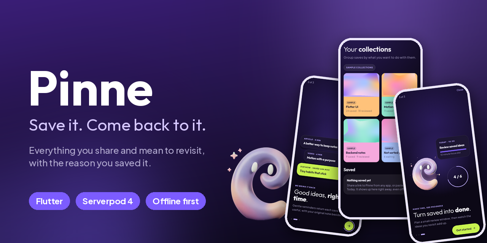
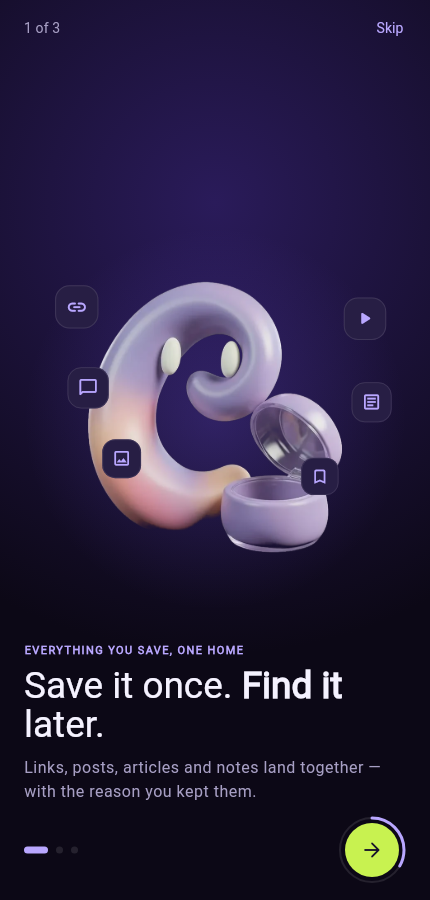
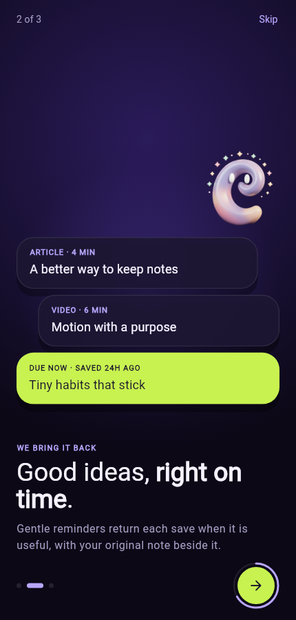
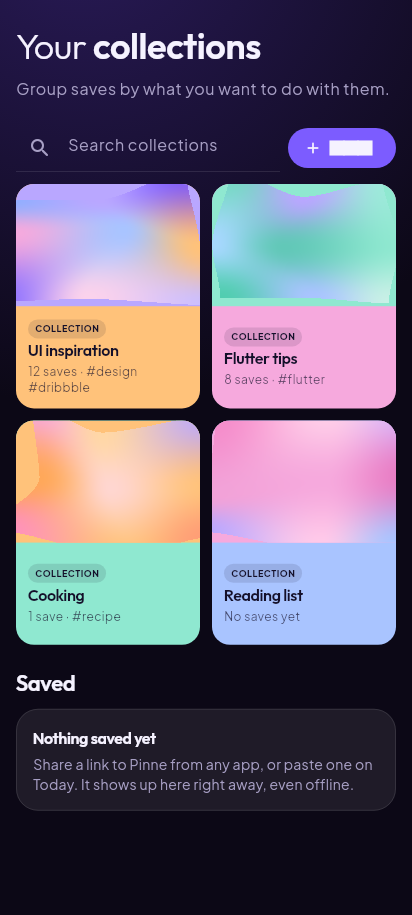
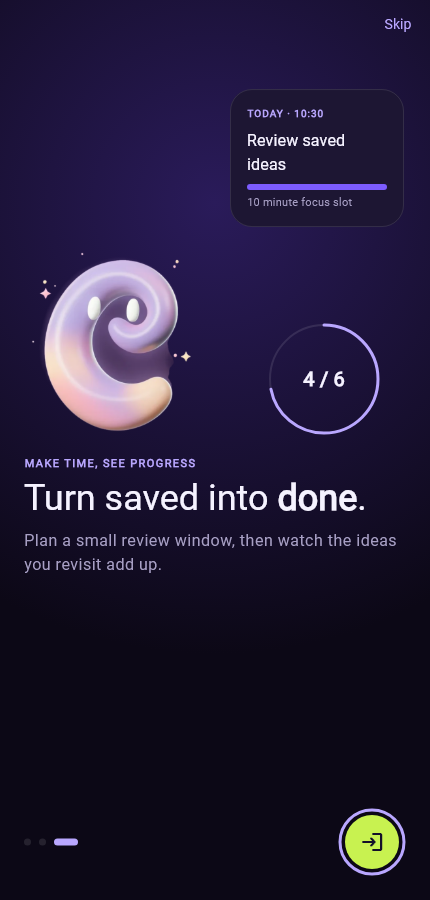
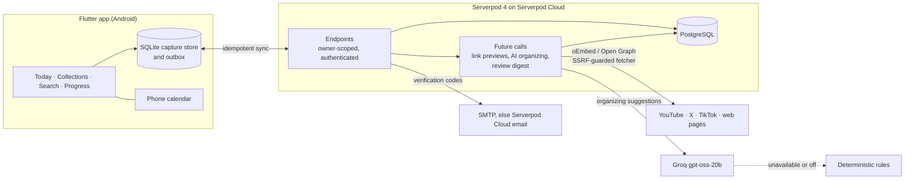
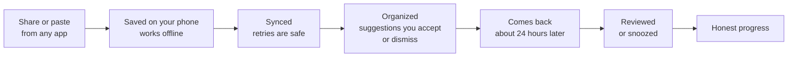

<p align="center">
  
</p>

<p align="center">
  <a href="https://github.com/MI-TECHDLIN/pinne/actions/workflows/ci.yml"></a>
  <a href="LICENSE"></a>
  <a href="https://serverpod.dev"></a>
  <a href="https://flutter.dev"></a>
</p>

# Pinne

**Save the things worth coming back to, then actually come back to them.**

We save everything: the thread, the video, the article we will "read later".
Then we never look at it again. Every app has its own pile, and none of them
remember *why* we saved something or bring it back when it would help.

Pinne is for anyone whose saved posts have become a graveyard. Share a link
from X, YouTube or the web into one place, jot a line on why it mattered, and
Pinne brings it back about a day later, one calm review at a time. A small
character, the Ribbon Spirit, keeps you company and keeps the progress honest.

<p align="center">
  
  
  
  
</p>

**Quick links:**
[Try it](#testing-instructions-for-judges) ·
[Run locally](#run-it-locally) ·
[Deploy](docs/deploy.md) ·
[Roadmap](#whats-next) ·
[AI and data terms](docs/ai.md)

> **Project status:** Pinne started as a hackathon entry (deadline
> 2026-10-14) and is being built toward a polished public release.

## How Pinne works

Pinne is a Flutter app on top of a [Serverpod](https://serverpod.dev) 4
backend with PostgreSQL. The phone is the source of truth for a fresh save;
the server organizes, schedules and keeps everything owner-scoped.



Link previews and the digest scheduler need durable future calls, which the
Starter hosting plan does not provide; details in
[docs/deploy.md](docs/deploy.md). AI providers and fallbacks are in
[docs/ai.md](docs/ai.md), the fetcher's safety rules in
[docs/link-previews.md](docs/link-previews.md).

### The life of a save



Nothing says "Saved" until the save is on the phone's disk, and nothing counts
as progress until you really reviewed it. Opening a link or undoing a review
never moves the numbers.

## Features

- **One home for everything you save.** Share from any app, or paste a link or
  jot a note. It lands in one list, even offline.
- **Your reason, saved with it.** "Why did you save this?" stays attached.
- **It comes back at the right time.** About a day later, in a queue sized to
  5, 10 or 20 minutes, with *Remind me later* when now is not the moment.
- **Find it by what you remember.** Search by the way you would describe it to
  a friend, filter by source, type or collection.
- **AI you control.** Collections, tags and summaries are suggestions that
  wait for your accept or dismiss, and never overwrite your choices. Without
  AI, plain rules take over.
- **Plan time for it.** The Planner finds free time in your phone calendar and
  schedules sessions only when you accept.
- **Honest progress.** Review rate, weekly goal and milestones come only from
  real reviews.
- **Private by design.** Every row belongs to one owner, and previews are
  fetched through a guarded, plain-text-only path.

### Why not just use bookmarks?

| | Saved in each app | Pinne |
| --- | --- | --- |
| Where it lives | One pile per app: Instagram Saved, X Bookmarks, YouTube Watch later, Reddit Saved | One home across apps |
| Why you saved it | The built-in features do not mention a note | Your reason is saved with it |
| Coming back | A list you must remember to open | Comes back about a day later, sized to your time |
| Progress | Saving feels like progress | Only real reviews count |
| AI | None, or it decides for you | Suggestions you accept or dismiss |

The left column describes what each app's official help pages document
(Instagram, X, YouTube, TikTok and Reddit); it is a comparison of documented
features, not a claim that no app ever sends a reminder. Research on
bookmarking is consistent with the pile-up: a study of browser users found
that bookmarks were [added far faster than they were deleted](https://www.csse.canterbury.ac.nz/andrew.cockburn/papers/itsRevisitation.pdf)
(Cockburn et al., 2003, an early-web study, so read it as "piles grow", not
as a number about today's apps).

## Layout

| Path | What it is |
| --- | --- |
| `pinne_server/` | Serverpod server: models (`*.spy.yaml`), endpoints, migrations, tests |
| `pinne_client/` | Generated client package. Do not edit by hand |
| `pinne_flutter/` | Flutter app: Riverpod state, go_router navigation, design tokens |
| `pinne_capture/` | Pure Dart capture rules shared by server and app: source detection, URL normalization |
| `pinne_calendar/` | Pure Dart calendar rules shared by server and app: busy intervals, the calendar adapter contract, the slot planner, `.ics` export |
| `tool/setup_dev_secrets.sh` | Creates local secrets for development and tests |

## Prerequisites

- Flutter 3.47+ (Dart 3.13+)
- Docker, for the development PostgreSQL
- Serverpod CLI 4.x: `dart pub global activate serverpod_cli`, with
  `~/.pub-cache/bin` on your `PATH`

## Run it locally

All commands start from the repo root.

1. **Install dependencies and create local secrets** (first time only):

   ```bash
   flutter pub get
   tool/setup_dev_secrets.sh
   ```

   This writes `pinne_server/config/passwords.yaml` and `pinne_server/.env`
   with random values. Both files are git-ignored. The template, with every
   key explained, is `pinne_server/config/passwords.yaml.example`.

2. **Start the database:**

   ```bash
   cd pinne_server && docker compose up -d && cd ..
   ```

   PostgreSQL 16 listens on `localhost:8090`.

3. **Run the server** and apply migrations:

   ```bash
   cd pinne_server && dart run bin/main.dart --apply-migrations
   ```

   The API is on `http://localhost:8080`. Check it with:

   ```bash
   curl -X POST http://localhost:8080/health/check -d '{}'
   ```

   `serverpod start` (from `pinne_server/`) does steps 2 and 3 for you and
   adds hot reload, code generation on save, and launches the app.

4. **Run the app** in another terminal:

   ```bash
   cd pinne_flutter && flutter run
   ```

   The server URL comes from `--dart-define=SERVER_URL=...`, else `apiUrl` in
   `pinne_flutter/assets/config.json`, else `http://localhost:8080/`. On a
   physical phone use your computer's LAN address. Release builds for phones
   without `SERVER_URL` use the hosted API,
   `https://pinneapp.api.serverpod.space/`, instead of `config.json`.

## Sign-in

**Try without an account** creates a normal server-side auth user immediately.
Its UUID flows through the same `session.ownerId` checks as every other user,
so guest saves remain isolated. The session credential is held in secure
storage on that device; signing out, clearing app data or uninstalling can make
the guest account and its saves unavailable.

Serverpod 4.0.3 marks its anonymous provider experimental and explicitly says
that [anonymous account linking is not supported yet](https://docs.serverpod.dev/concepts/authentication/providers/anonymous/setup).
The installed provider creates an `AuthUser` and describes anonymous sessions
as non-restorable after device access is lost
([4.0.3 API](https://pub.dev/documentation/serverpod_auth_idp_server/4.0.3/providers_anonymous/AnonymousIdp-class.html)).
Serverpod separately provides account merging, but applications must implement
how every owned row and conflict is migrated
([Serverpod merging guide](https://docs.serverpod.dev/concepts/authentication/working-with-users#merging-accounts)).
Pinne therefore does not offer a fake “add email” upgrade: Settings explains
the limitation until an audited merge of all owned Pinne tables is built.

Email/password sign-in remains available and unchanged. In development and
tests, registration and password-reset codes are printed in the server console.
For staging or production, codes go through SMTP when it is configured in the
git-ignored `pinne_server/config/passwords.yaml` (`smtpHost`, `smtpPort`,
optional `smtpUsername`/`smtpPassword`, `smtpFromEmail`, `smtpFromName`,
`smtpSsl`) or the matching `PINNE_SMTP_*` environment variables, and otherwise
(or when SMTP fails) through the Serverpod Cloud email service, whose
`scloudAuthEmailKey` Serverpod Cloud sets on deploy. Serverpod Cloud could not
reach Gmail SMTP in production, so there the Cloud service is the working
route. Each failed route is logged as `ERROR: Email delivery: ...` without the
code or secrets. With no route at all the server logs a warning, rejects code
requests instead of silently discarding them, and the app points new users to
guest access.

To create or verify the empty judge demo account idempotently, set
`demoAccountEmail` and `demoAccountPassword` in the active secrets section (or
`PINNE_DEMO_ACCOUNT_EMAIL` / `PINNE_DEMO_ACCOUNT_PASSWORD`) and run while the
database port is available:

```bash
cd pinne_server
dart run bin/main.dart --seed-demo
```

The command uses Serverpod's email-account admin API, creates no example saves,
and prints whether it created the account or found it already present. Never
commit the real judge credentials; supply them only in the submission form.

Google sign-in is wired in but stays off until real credentials exist:

1. Create OAuth clients in Google Cloud Console (a Web client for the server,
   plus Android/iOS clients for the app).
2. Paste the Web client JSON as `googleClientSecret` in
   `pinne_server/config/passwords.yaml` (see the commented example there).
3. Run the app with
   `--dart-define=GOOGLE_CLIENT_ID=<app client id> --dart-define=GOOGLE_SERVER_CLIENT_ID=<web client id>`.

Without these the server logs `Google sign-in is disabled` and the app hides
the Google button. Never commit real credentials.

## Testing instructions for judges

1. Install the supplied Pinne APK and open it while connected to the internet.
2. Tap **Try without an account**. No email, code or external account is
   required; the guest gets a private, empty Pinne workspace immediately.
3. On Today, tap **Load examples**. Three of the six example saves are due
   right away: open one from the review queue and tap **Reviewed** to complete
   the save-and-review flow. Progress counts each review.
4. Save a link or note on Today and confirm it appears in Collections → Saved,
   with any AI suggestions (collection, tags, summary) to accept or dismiss.
   New saves come back for review in about 24 hours.
5. Alternatively, choose email sign-in and use the demo email and password
   included in the private submission form. That account also starts empty.
6. Guest access is device-bound. Do not sign out, clear app data or uninstall
   until testing is complete, because Serverpod 4.0.3 cannot yet link that
   guest to email in place.

## Capture

Saving is local-first. A share or paste is written to a SQLite database on
the phone (WAL, `synchronous = FULL`, item and outbox row in one
transaction) before the app says "Saved", so it survives the app being
killed. An outbox then sends it to `item.capture`, retrying with backoff;
an operation leaves the outbox only once the server confirms it. Retries
reuse the same operation id, and the server answers a repeat with the same
result. Signed-out or offline captures wait on the phone and sync after
sign-in or reconnect. Code: `pinne_flutter/lib/features/capture/` and
`pinne_server/lib/src/items/item_capture.dart`.

- **Android:** `ShareActivity` receives `text/plain` shares (links and text)
  and shows the compact "Saved to Pinne" sheet over the app that shared,
  running the `shareMain` entrypoint in `lib/main.dart`. Done returns there.
  The sheet's engine closes with it, so it tries one send on Done and
  otherwise leaves the capture to the main app, which drains the outbox on
  start, resume, sign-in and reconnect. Background sync without opening the
  app (WorkManager) is not built yet.
- **Manual:** paste a link or type a note on Today. Captures show under
  Collections, in Saved.
- **Web:** has no durable local store, so capture is hidden there.

### iOS Share Extension (not built yet)

It needs a Mac with Xcode. To add it:

1. In `pinne_flutter/ios/Runner.xcworkspace`, add a **Share Extension**
   target (for example `ShareExtension`, bundle id
   `<Runner bundle id>.ShareExtension`), embedded in Runner, with the same
   team and minimum iOS version as Runner.
2. Add the **App Groups** capability to both Runner and the extension with
   one shared group (for example `group.<Runner bundle id>`). This writes
   `com.apple.security.application-groups` into `Runner.entitlements` and
   `ShareExtension.entitlements`. Register the group in the Apple Developer
   account and regenerate both provisioning profiles.
3. In the extension's `Info.plist`, set `NSExtensionActivationRule` to accept
   web URLs (`NSExtensionActivationSupportsWebURLWithMaxCount` = 1) and text
   (`NSExtensionActivationSupportsText` = true).
4. Move the capture database into the App Group container
   (`FileManager.containerURL(forSecurityApplicationGroupIdentifier:)`) so
   both processes reach it. `path_provider` cannot return that path; add a
   small platform channel for `openCaptureStore()` on iOS.
5. In the extension, persist the raw shared text to the shared container
   before showing "Saved" (native Swift, no Flutter engine, to stay inside
   the extension memory limit), then call
   `extensionContext.completeRequest` to return to the source app. The main
   app imports those rows on launch or resume, parses them with
   `pinne_capture` and queues them in the outbox.

## Calendar planning

Today → **Plan** opens the Planner. It proposes short review sessions in free
time, shows what was checked ("Checked your busy times 2 minutes ago"), and
schedules them only after you accept. Code: `pinne_flutter/lib/features/planner/`,
`pinne_server/lib/src/planning/` and `pinne_calendar/`.

| Route | Busy times | Sessions | Notes |
| --- | --- | --- | --- |
| Android phone calendars | Read on the phone from the calendars you check | Written to the one calendar you choose | Uses [`device_calendar_plus`](https://pub.dev/packages/device_calendar_plus) 0.10.1 (MIT). Asks for `READ_CALENDAR` and `WRITE_CALENDAR` only when you tap *Allow calendar access*. |
| Calendar file (.ics) | No | You import the file | Export only: not live sync and not proof of free time. |

How it stays honest:

- **Unknown is never free.** A plan is "checked" only when every calendar
  chosen for busy times was read on this phone in the last 15 minutes over
  the whole period. Otherwise it cannot be accepted as checked; you can only
  *Keep in Pinne without checking*, which writes nothing to a calendar and
  labels the sessions.
- **Accept rechecks.** Accepting reads busy times again. A new clash revises
  the plan instead of scheduling over it.
- **No duplicates.** The server stores each session and its calendar
  operation before the phone writes anything. The phone marks every event it
  writes with the session's id and looks for that mark before creating,
  moving or removing, so a write whose answer was lost is found, not
  repeated, and an event Pinne did not create is never changed.
- **Your calendar edits win.** Moving or deleting a Pinne event in your
  calendar app moves or cancels the session the next time the Planner opens.
- Calendar titles say only "Pinne review"; saved items' names stay in Pinne.
- Device calendar ids are stored with the install's id; only that phone acts
  on them. Disconnecting keeps scheduled sessions and existing events.

Planner settings (the sliders icon) set the week or month horizon, days,
daily window, session length, how many sessions, buffers around events,
earliest start, and whether plans need your acceptance or are suggestions
only. Items in sessions are your active, unreviewed saves for now
(`SessionItemSource` is the seam for the review queue).

## Progress

The Progress tab shows honest numbers for a save cohort (this week, last
week or this month): a deck of tilted metric cards you can flick through,
saved/reviewed/upcoming pills, the review rate with its trend, the weekly
goal, per-collection rates and review days. New milestones get a one-time
celebration with the Ribbon Spirit. Formulas, screenshots and how to
re-render them: [`docs/progress/`](docs/progress/README.md).

## First run, tour and errors

Three onboarding screens adapt to every phone size and large text
([`docs/onboarding/`](docs/onboarding/)). The first time Today opens, a
seven-step tour spotlights its parts and the tabs; Settings > Guides replays
it ([`docs/tour/`](docs/tour/README.md)). Failures show plain-language cards
and toasts, never raw exceptions ([`docs/errors/`](docs/errors/README.md)).

## Checks

```bash
(cd pinne_server && serverpod generate)   # after changing models or endpoints
(cd pinne_calendar && dart analyze && dart test)
(cd pinne_capture && dart analyze && dart test)
(cd pinne_server && dart analyze && dart test)
(cd pinne_flutter && flutter analyze && flutter test)
```

Server tests need no Docker. They start an embedded PostgreSQL that Serverpod
manages (`config/test.yaml` sets `dataPath`), so `tool/setup_dev_secrets.sh`
must have run once. CI runs the same steps (`.github/workflows/ci.yml`).

## Changing the schema

Edit the `.spy.yaml` models, then from `pinne_server/`:

```bash
serverpod generate
serverpod create-migration
dart run bin/main.dart --apply-migrations
```

## AI art

The Ribbon Spirit stills in `pinne_flutter/assets/art/` were generated with
FLUX.2 [klein] 4B (Apache-2.0). Prompts, seeds, the licence record and the
AI-use disclosure for the submission are in
[`docs/ai-art/README.md`](docs/ai-art/README.md). The animated spirit in the
app is drawn in code (`docs/ribbon-spirit/`).

## What's Next

The hackathon is Pinne's first stage, not the finish line. The plan is to keep
improving Pinne for real users and grow it toward a sustainable startup,
without presenting roadmap items as features that already exist. These are
directions, not dated promises.

- **Reminders that find you.** Today the review queue lives in the app.
  Step 1 is on-device reminders with `flutter_local_notifications`: no server
  involved, so a save can nudge you about a day later even if you never open
  Pinne. Step 2 is push notifications through Firebase Cloud Messaging, with
  Serverpod future calls deciding when to send (about 24 hours after a save,
  quiet hours, a daily cap). Android comes first; iOS needs an APNs key from a
  paid Apple Developer account.
- **A light theme, Lavender Mist,** alongside the dark violet one.
- **Google Calendar and Apple Calendar.** Today the app uses calendars on the
  phone, and `.ics` export stays available. Direct connections return when
  they can be authenticated, synchronized, tested and described honestly.
- **Production hosting.** Link previews and the digest are off on the current
  Serverpod Cloud Starter deployment because they need a plan with durable
  future calls. A production deployment restores them with monitoring, retries
  and operational safeguards. Push notifications need the same.
- **Store releases.** Google Play and the Apple App Store, after compliance,
  privacy, security and release processes are in place. There is no Mac for
  iOS yet, so iOS builds will use a cloud macOS build service or a Mac.
- **A stronger everyday experience.** Broader capture and review flows, better
  organization and retrieval, accessibility and reliability work, guided by
  real feedback.

## License

Pinne is released under the [MIT License](LICENSE). The licence record for
the AI-generated art is in [docs/ai-art/README.md](docs/ai-art/README.md).
