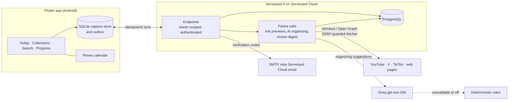
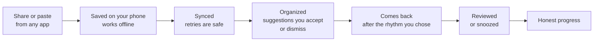

<p align="center">
  
</p>

<p align="center">
  <a href="https://github.com/MI-TECHDLIN/pinne/actions/workflows/ci.yml"></a>
  <a href="LICENSE"></a>
  <a href="https://serverpod.dev"></a>
  <a href="https://flutter.dev"></a>
</p>

# Pinne

**Save the things worth coming back to, then actually come back to them.**

We save everything: the thread, the video, the article we will "read later".
Then we never look at it again. Every app has its own pile, and none of them
remember *why* we saved something or bring it back when it would help.

Pinne is for anyone whose saved posts have become a graveyard. Share a link
from X, YouTube or the web into one place, jot a line on why it mattered, and
Pinne brings it back when you choose, one calm review at a time. A small
character, the Ribbon Spirit, keeps you company and keeps the progress honest.

<p align="center">
  
  
  
  
</p>

**Quick links:**
[Try it](#testing-instructions-for-judges) ·
[Setup](#setup-and-configuration) ·
[Run locally](#run-locally) ·
[Deploy](#deploy-to-serverpod-cloud) ·
[Android APK](#build-the-android-apk) ·
[Roadmap](#whats-next) ·
[AI and data terms](docs/ai.md)

> **Project status:** Pinne started as a hackathon entry (deadline
> 2026-10-14) and is being built toward a polished public release.

## How Pinne works

Pinne is a Flutter app on top of a [Serverpod](https://serverpod.dev) 4
backend with PostgreSQL. The phone is the source of truth for a fresh save;
the server organizes, schedules and keeps everything owner-scoped.



Link previews and the digest scheduler need durable future calls, which the
Starter hosting plan does not provide; details in
[docs/deploy.md](docs/deploy.md). AI providers and fallbacks are in
[docs/ai.md](docs/ai.md), the fetcher's safety rules in
[docs/link-previews.md](docs/link-previews.md).

### The life of a save



Nothing says "Saved" until the save is on the phone's disk, and nothing counts
as progress until you really reviewed it. Opening a link or undoing a review
never moves the numbers.

## Features

- **One home for everything you save.** Share from any app, or paste a link or
  jot a note. It lands in one list, even offline.
- **Your reason, saved with it.** "Why did you save this?" stays attached.
- **It comes back at the right time.** Choose **Bring saves back after** one
  hour, one day, three days or one week. New and still-unreviewed saves follow
  that rhythm, in a queue sized to 5, 10 or 20 minutes, with *Remind me later*
  when now is not the moment.
- **Collections that are yours.** Create a collection with its own name,
  colour and description, edit it whenever you like, and search your saves by
  collection.
- **Find it by what you remember.** Search by the way you would describe it to
  a friend, filter by source, type or collection.
- **AI you control.** Pinne checks your existing collections first. It only
  proposes a new one when nothing is related, tells you why, and waits for
  your accept or dismiss. Accepted updates appear everywhere straight away;
  without AI, plain rules take over.
- **The original is one tap away.** Tap a saved card to open the post, video
  or article in its original app.
- **Plan time for it.** The Planner finds free time in your phone calendar and
  schedules sessions only when you accept.
- **Honest progress, at your pace.** Review rate and milestones come only from
  real reviews. Set a goal for this week, this month or a custom 3–365-day
  streak, including how many review days feel right for you.
- **Private by design.** Every row belongs to one owner, and previews are
  fetched through a guarded, plain-text-only path.

### Why not just use bookmarks?

| | Saved in each app | Pinne |
| --- | --- | --- |
| Where it lives | One pile per app: Instagram Saved, X Bookmarks, YouTube Watch later, Reddit Saved | One home across apps |
| Why you saved it | The built-in features do not mention a note | Your reason is saved with it |
| Coming back | A list you must remember to open | Comes back after the rhythm you choose, sized to your time |
| Progress | Saving feels like progress | Only real reviews count |
| AI | None, or it decides for you | Suggestions you accept or dismiss |

The left column describes what each app's official help pages document
(Instagram, X, YouTube, TikTok and Reddit); it is a comparison of documented
features, not a claim that no app ever sends a reminder. Research on
bookmarking is consistent with the pile-up: a study of browser users found
that bookmarks were [added far faster than they were deleted](https://www.csse.canterbury.ac.nz/andrew.cockburn/papers/itsRevisitation.pdf)
(Cockburn et al., 2003, an early-web study, so read it as "piles grow", not
as a number about today's apps).

## Layout

| Path | What it is |
| --- | --- |
| `pinne_server/` | Serverpod server: models (`*.spy.yaml`), endpoints, migrations, tests |
| `pinne_client/` | Generated client package. Do not edit by hand |
| `pinne_flutter/` | Flutter app: Riverpod state, go_router navigation, design tokens |
| `pinne_capture/` | Pure Dart capture rules shared by server and app: source detection, URL normalization |
| `pinne_calendar/` | Pure Dart calendar rules shared by server and app: busy intervals, the calendar adapter contract, the slot planner, `.ics` export |
| `tool/setup_dev_secrets.sh` | Creates local secrets for development and tests |

## Setup and configuration

Everything needed to configure Pinne is listed here. Commands start at the
repository root unless a step says otherwise. Never commit
`pinne_server/config/passwords.yaml`, `pinne_server/.env`, OAuth JSON, or a
keystore.

### Prerequisites

- Flutter **3.47.3**, the version pinned by CI (the package constraint is
  Flutter 3.44.4+), with Dart **3.12.2+**.
- Docker with Compose, for the local PostgreSQL 16 database.
- Serverpod CLI **4.0.3**, matching the server packages:
  `dart pub global activate serverpod_cli 4.0.3`. Put Dart's global executable
  directory on `PATH`.
- Android builds additionally need the Android SDK and Java 17. `adb` is
  optional for installing an APK from the command line.

### Server passwords and secrets

For local development, run `tool/setup_dev_secrets.sh`. It creates the
git-ignored `pinne_server/config/passwords.yaml` from
`pinne_server/config/passwords.yaml.example`, generates the required
development/test values, and writes the matching `PINNE_DEV_DB_PASSWORD` to
the git-ignored `pinne_server/.env`. It refuses to overwrite existing files
unless passed `--force`. Any password can instead be supplied as
`SERVERPOD_PASSWORD_<name>`.

On Serverpod Cloud, use
`serverpod cloud password set <name> "<VALUE>"`; Cloud injects the value for
`Serverpod.getPassword(name)`. Do not set the Cloud-managed rows below.

| Name | Required? | Used for / behavior when absent | Where to set |
| --- | --- | --- | --- |
| `database` | Yes locally; Cloud-managed | PostgreSQL authentication; the local value must equal `PINNE_DEV_DB_PASSWORD` | Generated in local `passwords.yaml`; supplied by Cloud |
| `serviceSecret` | Yes in development; Cloud-managed | Serverpod service-to-service authentication | Generated in local `passwords.yaml`; supplied by Cloud |
| `emailSecretHashPepper` | Yes | Hashes email verification secrets | Generated locally; supplied by Cloud |
| `jwtHmacSha512PrivateKey` | Yes | Signs JWT access tokens | Generated locally; supplied by Cloud |
| `jwtRefreshTokenHashPepper` | Yes | Hashes JWT refresh tokens | Generated locally; supplied by Cloud |
| `groqApiKey` | No; required only for Groq organizing | Primary AI provider. Without it, Gemini is tried; without either key, deterministic rules organize saves | Local `passwords.yaml`; `serverpod cloud password set groqApiKey "<YOUR_GROQ_API_KEY>"` |
| `geminiApiKey` | No | Secondary AI provider, used only when Groq is not configured. Without either key, deterministic rules are used | Local `passwords.yaml`; `serverpod cloud password set geminiApiKey "<YOUR_GEMINI_API_KEY>"` |
| `googleClientSecret` | No | Google sign-in Web OAuth client JSON. When absent, the server disables Google sign-in | Local `passwords.yaml`; `serverpod cloud password set googleClientSecret "<YOUR_GOOGLE_OAUTH_WEB_CLIENT_JSON>"` |
| `googleCalendarClientSecret` | No | Reserved for Google Calendar OAuth. The route reports “not configured” without it and “not built yet” with it; device calendars and `.ics` need no secret | Local `passwords.yaml`; `serverpod cloud password set googleCalendarClientSecret "<YOUR_GOOGLE_CALENDAR_OAUTH_JSON>"` |
| `demoAccountEmail` | Only when seeding the demo account | Identifies and labels the private judge account; seeding fails if it or the password is absent | Local `passwords.yaml` or `PINNE_DEMO_ACCOUNT_EMAIL`; Cloud password of the same name |
| `demoAccountPassword` | Only when seeding the demo account | Password for the private judge account; seeding fails if it or the email is absent | Local `passwords.yaml` or `PINNE_DEMO_ACCOUNT_PASSWORD`; Cloud password of the same name |
| `smtpHost` | No; SMTP needs this and `smtpFromEmail` | Optional first route for production auth codes. If incomplete or delivery fails, the Cloud email route is tried | Local `passwords.yaml` or `PINNE_SMTP_HOST`; Cloud password of the same name |
| `smtpPort` | No | SMTP port; defaults to `587`. Invalid values disable SMTP | Local `passwords.yaml` or `PINNE_SMTP_PORT`; Cloud password of the same name |
| `smtpUsername` | No; pair with `smtpPassword` | SMTP authentication. Setting only one of the pair disables SMTP | Local `passwords.yaml` or `PINNE_SMTP_USERNAME`; Cloud password of the same name |
| `smtpPassword` | No; pair with `smtpUsername` | SMTP authentication secret | Local `passwords.yaml` or `PINNE_SMTP_PASSWORD`; Cloud password of the same name |
| `smtpFromEmail` | Required when SMTP is used | Sender address; SMTP is disabled without it | Local `passwords.yaml` or `PINNE_SMTP_FROM_EMAIL`; Cloud password of the same name |
| `smtpFromName` | No | Sender name; defaults to `Pinne` | Local `passwords.yaml` or `PINNE_SMTP_FROM_NAME`; Cloud password of the same name |
| `smtpSsl` | No | Set `true` for implicit TLS (usually port 465); otherwise STARTTLS is used | Local `passwords.yaml` or `PINNE_SMTP_SSL`; Cloud password of the same name |
| `scloudAuthEmailKey` | Cloud-managed | Authorizes Serverpod Cloud's HTTPS email service. In staging/production, no SMTP and no Cloud key makes email registration/reset unavailable; guest sign-in still works | Automatically supplied by Serverpod Cloud on deploy |

Development and tests print registration and reset codes to the server
console, so SMTP is ignored in those modes. Serverpod Cloud can block SMTP
(Gmail SMTP is known not to work there); its HTTPS email service is the
reliable fallback.

### Runtime variables and Flutter build defines

| Name | Default / behavior | Where to set |
| --- | --- | --- |
| `PINNE_AI_ENABLED` | AI is enabled; set exactly `false` (case-insensitive) to force deterministic rules even when a provider key exists | Server process environment; on Cloud use `serverpod cloud variable set PINNE_AI_ENABLED "false"` |
| `PINNE_SEED_DEMO_ON_START` | Off; `true` runs the idempotent demo seeder after startup | Server process environment; use only temporarily on Cloud, then unset it and redeploy |
| `SERVER_URL` | Debug uses `assets/config.json` and then `http://localhost:8080/`; a release phone build uses `https://pinneapp.api.serverpod.space/`; hosted web derives the matching Cloud API host | Flutter `--dart-define=SERVER_URL=<URL>`; include the trailing slash |
| `GOOGLE_CLIENT_ID` | Absent; the app hides Google sign-in | Flutter `--dart-define=GOOGLE_CLIENT_ID=<APP_CLIENT_ID>` |
| `GOOGLE_SERVER_CLIENT_ID` | Absent; required with the app client ID for Google sign-in | Flutter `--dart-define=GOOGLE_SERVER_CLIENT_ID=<WEB_CLIENT_ID>` |

The server also recognizes the `PINNE_SMTP_*` and `PINNE_DEMO_ACCOUNT_*`
aliases shown in the password table. Google sign-in needs Android/iOS OAuth
clients plus the server's Web client JSON. No other `--dart-define` is read by
the product app.

### Server and build configuration files

- `pinne_server/config/development.yaml` exposes API/Insights/web on
  `8080`/`8081`/`8082`, connects to PostgreSQL `pinne` on `localhost:8090`,
  and enables persistent and console logs. Future calls use Serverpod's
  enabled defaults.
- `pinne_server/config/test.yaml` uses random ports and Serverpod's embedded
  PostgreSQL at `.serverpod/test/pgdata`; tests need no Docker.
- `pinne_server/config/staging.yaml` and
  `pinne_server/config/production.yaml` contain self-hosting placeholders for
  public hosts and TLS PostgreSQL. Serverpod Cloud overrides hosts, ports,
  database, and logging. Both cap requests at 512 KiB; production enables
  durable future calls and disables console session logs.
- `pinne_server/config/generator.yaml` sends generated server code to
  `lib/src/generated`, the client to `pinne_client`, and integration helpers to
  `test/integration/test_tools`. Never edit generated output by hand.
- `pinne_server/scloud.yaml` links project `pinneapp` and runs
  `serverpod generate` plus `serverpod run flutter_build` before deployment.
- `pinne_server/docker-compose.yaml` runs PostgreSQL 16 on port `8090` and
  reads `PINNE_DEV_DB_PASSWORD` from `.env`. There is no Redis configuration.
- `pinne_flutter/assets/config.json` is the debug fallback API URL.
- `.github/workflows/ci.yml` pins Flutter 3.47.3 and Serverpod 4.0.3, generates
  throwaway test secrets, and uses embedded PostgreSQL. CI requires no GitHub
  Actions secrets.

### Run locally

1. Install dependencies and generate local secrets:

   ```bash
   flutter pub get
   tool/setup_dev_secrets.sh
   ```

2. Generate Serverpod code and start PostgreSQL:

   ```bash
   cd pinne_server
   serverpod generate
   docker compose up -d
   ```

3. Apply the checked-in migrations and run the API:

   ```bash
   dart run bin/main.dart --apply-migrations
   ```

   The API is at `http://localhost:8080/`. From another terminal, verify it:

   ```bash
   curl -X POST http://localhost:8080/health/check -d '{}'
   ```

   Alternatively, run `serverpod start` inside `pinne_server`; it manages the
   database, migrations, generation/hot reload, and the configured Flutter
   companion app.

4. Run Flutter from another terminal. Choose the URL for the target:

   ```bash
   cd pinne_flutter
   flutter run -d chrome
   flutter run --dart-define=SERVER_URL=http://10.0.2.2:8080/
   ```

   The first command works for local web. The second is for the standard
   Android emulator, where `10.0.2.2` reaches the host. For a physical phone,
   replace it with the development computer's reachable LAN address; iOS
   Simulator can use `http://localhost:8080/`.

5. Optionally create or verify the empty local demo account configured by the
   secrets script:

   ```bash
   cd pinne_server
   dart run bin/main.dart --seed-demo
   ```

   The command is idempotent and creates no example saves.

When a `table` model changes, run `serverpod generate`, then
`serverpod create-migration`; inspect and commit the migration. Existing
migrations are applied by `--apply-migrations` locally and automatically on
Cloud deploy.

### Deploy to Serverpod Cloud

The live project is `pinneapp`; its API is
<https://pinneapp.api.serverpod.space/>. The full operator runbook is
[docs/deploy.md](docs/deploy.md).

1. Install/sign in to the matching CLI and enter the server directory:

   ```bash
   dart pub global activate serverpod_cli 4.0.3
   serverpod cloud auth login
   cd pinne_server
   ```

2. This checkout is already linked by `scloud.yaml`. For a new fork/project,
   run `serverpod cloud launch`, create/select the project, keep the managed
   database enabled, and choose a plan. Launch writes the link and performs
   the first deployment. Starter runs AI inline but has no durable future
   calls; Growth or higher is required for background link previews, AI, and
   the review digest.

3. Set only the custom passwords you need, using the exact names in the table:

   ```bash
   serverpod cloud password set groqApiKey "<YOUR_GROQ_API_KEY>"
   serverpod cloud password set demoAccountEmail "<JUDGE_DEMO_EMAIL>"
   serverpod cloud password set demoAccountPassword "<JUDGE_DEMO_PASSWORD>"
   serverpod cloud password list
   ```

   Add optional Gemini, Google, or SMTP values with the same command. Cloud
   supplies database/auth secrets and `scloudAuthEmailKey`; do not replace
   them. Cloud's email service handles signup/reset codes when SMTP is absent
   or unreachable.

4. Deploy:

   ```bash
   serverpod cloud deploy
   serverpod cloud status deployment show
   serverpod cloud status live
   serverpod cloud log --since 10m
   ```

   The pre-deploy hooks generate protocol code and build Flutter web. Cloud
   starts the new server with pending migrations applied; a failed migration
   prevents that release from becoming live. Cloud overrides the placeholder
   production hosts, ports, database connection, and logging settings.

5. If the private demo account is required, set both demo passwords, then run
   the one-off switch and remove it immediately after the log confirms success:

   ```bash
   serverpod cloud variable set PINNE_SEED_DEMO_ON_START "true"
   serverpod cloud deploy --redeploy
   serverpod cloud log --since 10m
   serverpod cloud variable unset PINNE_SEED_DEMO_ON_START
   serverpod cloud deploy --redeploy
   ```

### Build the Android APK

The released judge build is available from
<https://github.com/MI-TECHDLIN/pinne/releases> as the `pinne.apk` asset. To
build it yourself:

```bash
cd pinne_flutter
flutter pub get
flutter build apk --release \
  --dart-define=SERVER_URL=https://pinneapp.api.serverpod.space/
```

The output is `pinne_flutter/build/app/outputs/flutter-apk/app-release.apk`.
Install it with `adb install -r build/app/outputs/flutter-apk/app-release.apk`
or transfer and open it on a phone. The application ID is
`com.mitechdlin.pinne`; the manifest requests internet and calendar access and
registers `ShareActivity` for `text/plain` shares.

For this hackathon, the release build deliberately uses Android's debug signing
key so contributors can produce a sideloadable APK without a private keystore.
It is not Play Store-ready. Before a store release, create and protect a
private upload keystore and replace the release `signingConfig` in
`pinne_flutter/android/app/build.gradle.kts`; never commit its password or the
keystore.

## Sign-in

**Try without an account** creates a normal server-side auth user immediately.
Its UUID flows through the same `session.ownerId` checks as every other user,
so guest saves remain isolated. The session credential is held in secure
storage on that device; signing out, clearing app data or uninstalling can make
the guest account and its saves unavailable.

Serverpod 4.0.3 marks its anonymous provider experimental and explicitly says
that [anonymous account linking is not supported yet](https://docs.serverpod.dev/concepts/authentication/providers/anonymous/setup).
The installed provider creates an `AuthUser` and describes anonymous sessions
as non-restorable after device access is lost
([4.0.3 API](https://pub.dev/documentation/serverpod_auth_idp_server/4.0.3/providers_anonymous/AnonymousIdp-class.html)).
Serverpod separately provides account merging, but applications must implement
how every owned row and conflict is migrated
([Serverpod merging guide](https://docs.serverpod.dev/concepts/authentication/working-with-users#merging-accounts)).
Pinne therefore does not offer a fake “add email” upgrade: Settings explains
the limitation until an audited merge of all owned Pinne tables is built.

Email/password sign-in remains available. Development and tests print codes to
the server console; production delivery and all email, demo-account, and Google
OAuth settings are listed in [Setup and configuration](#setup-and-configuration).
With no production email route, the app directs new users to guest access.
Never publish the judge demo credentials.

## Testing instructions for judges

1. Install the supplied Pinne APK and open it while connected to the internet.
2. Tap **Try without an account**. No email, code or external account is
   required; the guest gets a private, empty Pinne workspace immediately.
3. On Today, tap **Load examples**. Three of the six example saves are due
   right away: open one from the review queue and tap **Reviewed** to complete
   the save-and-review flow. Progress counts each review.
4. Save a link or note on Today and confirm it appears in Collections → Saved,
   with any AI suggestions (collection, tags, summary) to accept or dismiss.
   New saves come back for review in about 24 hours.
5. Alternatively, choose email sign-in and use the demo email and password
   included in the private submission form. That account also starts empty.
6. Guest access is device-bound. Do not sign out, clear app data or uninstall
   until testing is complete, because Serverpod 4.0.3 cannot yet link that
   guest to email in place.

## Capture

Saving is local-first. A share or paste is written to a SQLite database on
the phone (WAL, `synchronous = FULL`, item and outbox row in one
transaction) before the app says "Saved", so it survives the app being
killed. An outbox then sends it to `item.capture`, retrying with backoff;
an operation leaves the outbox only once the server confirms it. Retries
reuse the same operation id, and the server answers a repeat with the same
result. Signed-out or offline captures wait on the phone and sync after
sign-in or reconnect. Code: `pinne_flutter/lib/features/capture/` and
`pinne_server/lib/src/items/item_capture.dart`.

- **Android:** `ShareActivity` receives `text/plain` shares (links and text)
  and shows the compact "Saved to Pinne" sheet over the app that shared,
  running the `shareMain` entrypoint in `lib/main.dart`. Done returns there.
  The sheet's engine closes with it, so it tries one send on Done and
  otherwise leaves the capture to the main app, which drains the outbox on
  start, resume, sign-in and reconnect. Background sync without opening the
  app (WorkManager) is not built yet.
- **Manual:** paste a link or type a note on Today. Captures show under
  Collections, in Saved.
- **Web:** has no durable local store, so capture is hidden there.

### iOS Share Extension (not built yet)

It needs a Mac with Xcode. To add it:

1. In `pinne_flutter/ios/Runner.xcworkspace`, add a **Share Extension**
   target (for example `ShareExtension`, bundle id
   `<Runner bundle id>.ShareExtension`), embedded in Runner, with the same
   team and minimum iOS version as Runner.
2. Add the **App Groups** capability to both Runner and the extension with
   one shared group (for example `group.<Runner bundle id>`). This writes
   `com.apple.security.application-groups` into `Runner.entitlements` and
   `ShareExtension.entitlements`. Register the group in the Apple Developer
   account and regenerate both provisioning profiles.
3. In the extension's `Info.plist`, set `NSExtensionActivationRule` to accept
   web URLs (`NSExtensionActivationSupportsWebURLWithMaxCount` = 1) and text
   (`NSExtensionActivationSupportsText` = true).
4. Move the capture database into the App Group container
   (`FileManager.containerURL(forSecurityApplicationGroupIdentifier:)`) so
   both processes reach it. `path_provider` cannot return that path; add a
   small platform channel for `openCaptureStore()` on iOS.
5. In the extension, persist the raw shared text to the shared container
   before showing "Saved" (native Swift, no Flutter engine, to stay inside
   the extension memory limit), then call
   `extensionContext.completeRequest` to return to the source app. The main
   app imports those rows on launch or resume, parses them with
   `pinne_capture` and queues them in the outbox.

## Calendar planning

Today → **Plan** opens the Planner. It proposes short review sessions in free
time, shows what was checked ("Checked your busy times 2 minutes ago"), and
schedules them only after you accept. Code: `pinne_flutter/lib/features/planner/`,
`pinne_server/lib/src/planning/` and `pinne_calendar/`.

| Route | Busy times | Sessions | Notes |
| --- | --- | --- | --- |
| Android phone calendars | Read on the phone from the calendars you check | Written to the one calendar you choose | Uses [`device_calendar_plus`](https://pub.dev/packages/device_calendar_plus) 0.10.1 (MIT). Asks for `READ_CALENDAR` and `WRITE_CALENDAR` only when you tap *Allow calendar access*. |
| Calendar file (.ics) | No | You import the file | Export only: not live sync and not proof of free time. |

How it stays honest:

- **Unknown is never free.** A plan is "checked" only when every calendar
  chosen for busy times was read on this phone in the last 15 minutes over
  the whole period. Otherwise it cannot be accepted as checked; you can only
  *Keep in Pinne without checking*, which writes nothing to a calendar and
  labels the sessions.
- **Accept rechecks.** Accepting reads busy times again. A new clash revises
  the plan instead of scheduling over it.
- **No duplicates.** The server stores each session and its calendar
  operation before the phone writes anything. The phone marks every event it
  writes with the session's id and looks for that mark before creating,
  moving or removing, so a write whose answer was lost is found, not
  repeated, and an event Pinne did not create is never changed.
- **Your calendar edits win.** Moving or deleting a Pinne event in your
  calendar app moves or cancels the session the next time the Planner opens.
- Calendar titles say only "Pinne review"; saved items' names stay in Pinne.
- Device calendar ids are stored with the install's id; only that phone acts
  on them. Disconnecting keeps scheduled sessions and existing events.

Planner settings (the sliders icon) set the week or month horizon, days,
daily window, session length, how many sessions, buffers around events,
earliest start, and whether plans need your acceptance or are suggestions
only. Items in sessions are your active, unreviewed saves for now
(`SessionItemSource` is the seam for the review queue).

## Progress

The Progress tab shows honest numbers for a save cohort (this week, last
week or this month): a deck of tilted metric cards you can flick through,
saved/reviewed/upcoming pills, the review rate with its trend, your chosen
week, month or custom streak goal, per-collection rates and review days. New milestones get a one-time
celebration with the Ribbon Spirit. Formulas, screenshots and how to
re-render them: [`docs/progress/`](docs/progress/README.md).

## First run, tour and errors

Three onboarding screens adapt to every phone size and large text
([`docs/onboarding/`](docs/onboarding/)). The first time Today opens, a
seven-step tour spotlights its parts and the tabs; Settings > Guides replays
it ([`docs/tour/`](docs/tour/README.md)). Failures show plain-language cards
and toasts, never raw exceptions ([`docs/errors/`](docs/errors/README.md)).

## Checks

```bash
(cd pinne_server && serverpod generate)   # after changing models or endpoints
(cd pinne_calendar && dart analyze && dart test)
(cd pinne_capture && dart analyze && dart test)
(cd pinne_server && dart analyze && dart test)
(cd pinne_flutter && flutter analyze && flutter test)
```

Server tests need no Docker. They start an embedded PostgreSQL that Serverpod
manages (`config/test.yaml` sets `dataPath`), so `tool/setup_dev_secrets.sh`
must have run once. CI runs the same steps (`.github/workflows/ci.yml`).

## Changing the schema

Edit the `.spy.yaml` models, then from `pinne_server/`:

```bash
serverpod generate
serverpod create-migration
dart run bin/main.dart --apply-migrations
```

## AI art

The Ribbon Spirit stills in `pinne_flutter/assets/art/` were generated with
FLUX.2 [klein] 4B (Apache-2.0). Prompts, seeds, the licence record and the
AI-use disclosure for the submission are in
[`docs/ai-art/README.md`](docs/ai-art/README.md). The animated spirit in the
app is drawn in code (`docs/ribbon-spirit/`).

## What's Next

The hackathon is Pinne's first stage, not the finish line. The plan is to keep
improving Pinne for real users and grow it toward a sustainable startup,
without presenting roadmap items as features that already exist. These are
directions, not dated promises.

- **Reminders that find you.** Today the review queue lives in the app.
  Step 1 is on-device reminders with `flutter_local_notifications`: no server
  involved, so a save can return after the rhythm you chose even if you never
  open Pinne. Step 2 is push notifications through Firebase Cloud Messaging,
  with Serverpod future calls respecting that rhythm, quiet hours and a daily
  cap. Android comes first; iOS needs an APNs key from a paid Apple Developer
  account.
- **Live updates with Serverpod streaming.** Suggestions, link previews and
  progress can arrive as they change instead of the app polling for them.
- **Smarter search.** AI-assisted query understanding and re-ranking can find
  meaning across your notes, summaries and collections, while fresh databases
  regain the full-text indexes needed for a fast, dependable foundation.
- **Keep your guest saves.** Move a guest workspace into a new account during
  sign-up, so trying Pinne first never means leaving useful saves behind.
- **Attachments.** Save screenshots, images and files alongside links and
  notes, backed by Serverpod file storage.
- **More reach.** Add an iOS share extension and App Store build, and shape the
  web experience into a responsive app that feels at home on a larger screen.
- **AI that scales.** Add capacity beyond the free provider tier and queue
  work gracefully when limits are busy, without losing a suggestion request.
- **Share with friends.** Share a single save or a whole collection with a
  friend, to view or to build together, and see what friends are saving. An
  optional, friendly leaderboard of review streaks would be open only to
  friends who opt in. Privacy comes first: nothing is shared by default.
- **Google Calendar and Apple Calendar.** Today the app uses calendars on the
  phone, and `.ics` export stays available. Direct connections return when
  they can be authenticated, synchronized, tested and described honestly.
- **Production hosting.** Link previews and the digest are off on the current
  Serverpod Cloud Starter deployment because they need a plan with durable
  future calls. A production deployment restores them with monitoring, retries
  and operational safeguards. Push notifications need the same.
- **Production readiness review.** A review of the app's architecture,
  security and data privacy, and of its policies: a privacy policy, terms of
  service, data deletion and export, and store compliance for Google Play and
  the App Store, so Pinne meets production requirements.
- **Rebranding.** A refreshed brand identity before public launch: a review
  of the name, plus the logo, icon set and store assets.
- **Store releases.** Google Play and the Apple App Store, after compliance,
  privacy, security and release processes are in place. There is no Mac for
  iOS yet, so iOS builds will use a cloud macOS build service or a Mac.
- **A stronger everyday experience.** Broader capture and review flows, better
  organization and retrieval, accessibility and reliability work, guided by
  real feedback.

## License

Pinne is released under the [MIT License](LICENSE). The licence record for
the AI-generated art is in [docs/ai-art/README.md](docs/ai-art/README.md).
