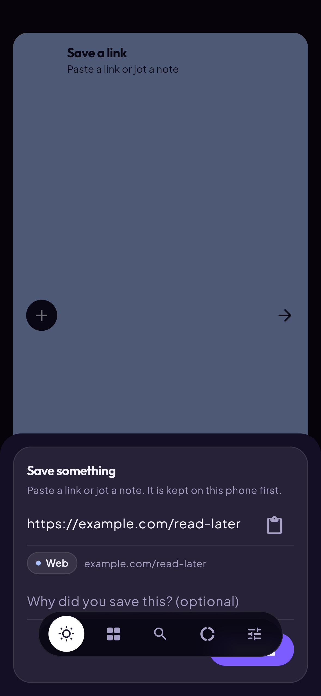
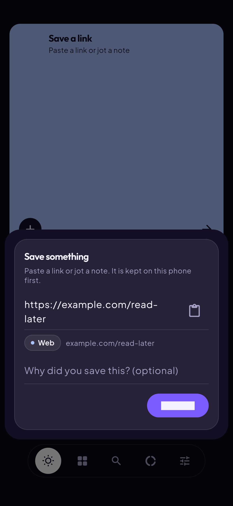
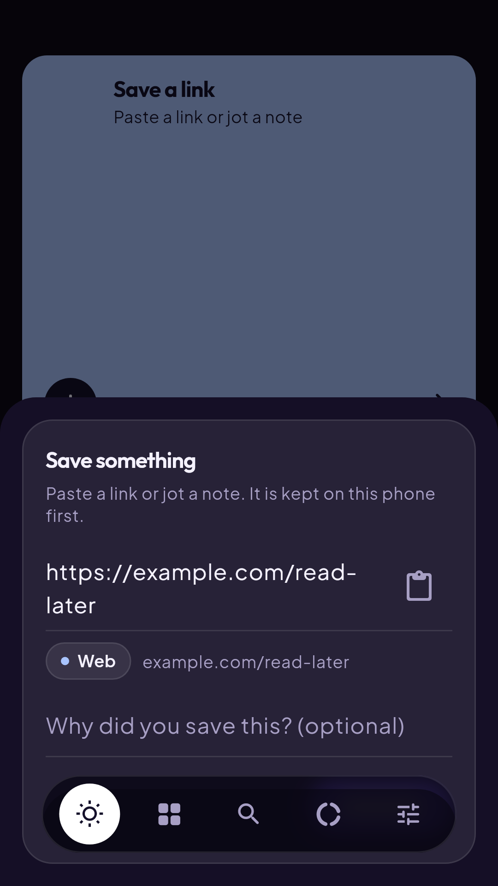
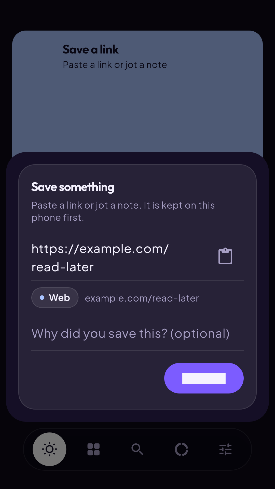
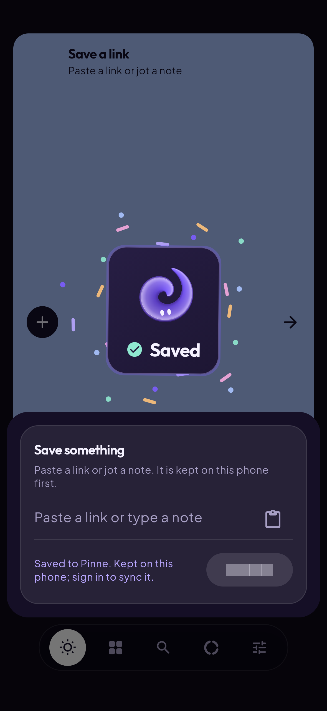
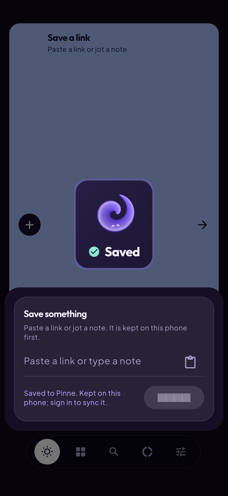

# Capture: the Save sheet and the save celebration

Goldens rendered by `pinne_flutter/test/capture/save_goldens_test.dart`
(Linux, Flutter pinned in `.github/workflows/ci.yml`). The `before-*` images
are one-off renders of the same test on the code before the fix; they are not
goldens.

| Before | After |
| --- | --- |
|  |  |
|  |  |

## Why the nav covered the Save sheet

- Trigger: tapping "Save a link" on Today, then entering a link. The link
  adds the source row and the "why" field, which makes the sheet taller.
- Mask: the sheet was pushed on the tab's own navigator, inside the shell
  `Scaffold` body. With `extendBody: true` the floating pill nav
  (`bottomNavigationBar`) paints over the body, so it painted over the
  sheet. The sheet's padding only followed the keyboard. While the keyboard
  is up, it covers the nav as well, so the bug only showed with the keyboard
  closed.
- Symptom: on 393x851 the "why" field, and on 360x640 the Save button, sat
  under the nav, and taps there reached the nav.

Search has no such problem: its field is inside `PinnePage`, which already
pads the bottom by `PinneSpacing.navClearance`.

The fix opens the sheet on the root navigator, above the shell. The sheet
floats above `FloatingPillNav.extentOf` or the keyboard, whichever is higher,
and scrolls when space is tight. Regression tests in
`test/capture/capture_widgets_test.dart` check the content field, the "why"
field and Save on both phones, with and without a 300 px keyboard. Each
control must be on screen, clear of the nav and able to receive a tap. The
same tests cover the Android share sheet, which was already fine.

## Save celebration

| Full motion (peak frame) | Reduced motion |
| --- | --- |
|  |  |

`showSaveCelebration` (`lib/features/capture/save_celebration.dart`) runs
for 1.4 s with a light haptic once a new save is on the phone, including
offline saves. The Spirit hops in a burst of ribbon sparkles in the
milestone confetti colours, never lime. It ignores taps and fades by itself;
a quick second save replaces it. A repeat save only shows "Already in
Pinne". Reduced motion shows the happy Spirit and a check without movement.
