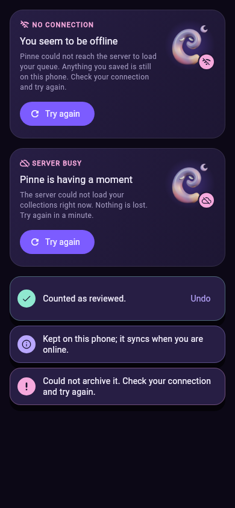
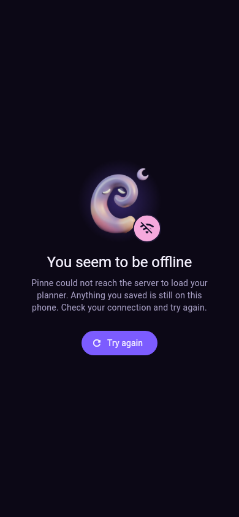

# Errors and toasts

Failures are described for people: what happened, what to do, and a way to
try again. Raw exception text and stack traces never reach the screen.

- Mapping: `FriendlyError.from(error, subject: 'your queue')` in
  `pinne_flutter/lib/ui/feedback/friendly_error.dart` turns any exception
  into a cause (offline, server, signed out, not found, refused, wrong
  password, too many tries, unknown) with a title, a message and a short
  hint. Pinne's own `ValidationException`, `PlanningException` and
  `CalendarRouteException` messages are shown as written; everything else
  uses fixed copy.
- Inline card: `PinneErrorCard` for a part of a screen that failed to load
  (Today queue, Collections, Search, Planner, Calendars, Progress).
- Full screen: `PinneErrorState`, used for broken links in the router.
- Toasts: `showPinneToast` (success, info, error) and `showErrorToast`
  (`'Could not archive it'` plus the hint) in `ui/feedback/toast.dart`
  replace the default grey snack bar. Plain `SnackBar`s still get a styled
  theme fallback.
- Offline saves: capture still says the save is kept on the phone and will
  sync (or needs sign-in to sync).

 

Rendered by `pinne_flutter/test/feedback_test.dart`.
