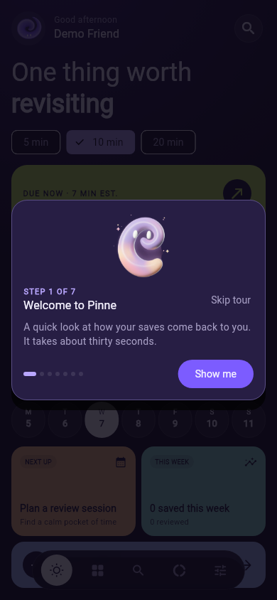
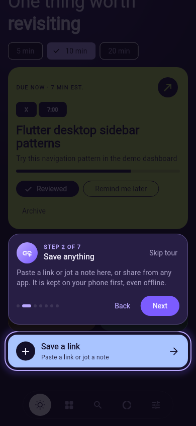
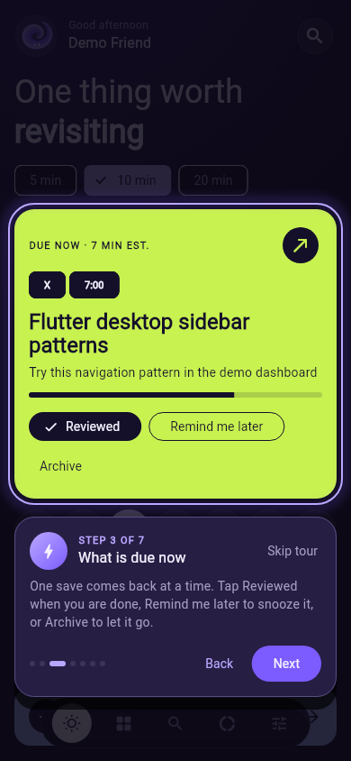
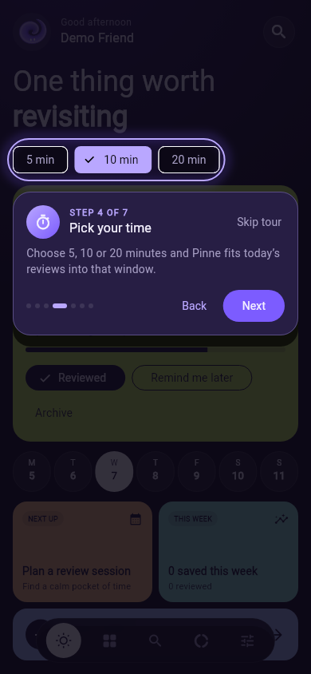
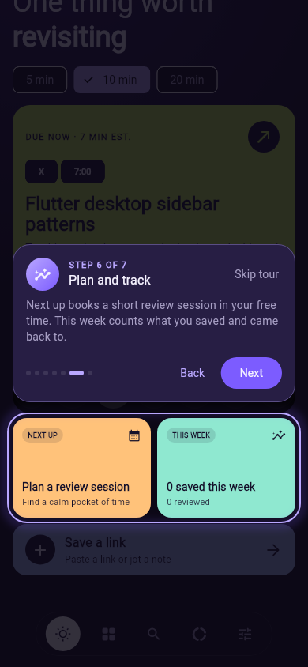
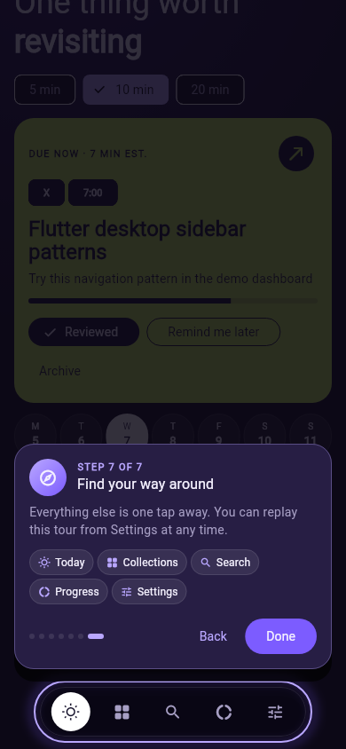
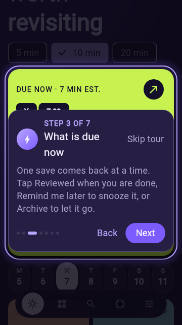

# Today tour

A coach-mark walkthrough shown the first time Today is on screen after
onboarding and sign-in. It dims the app, cuts a window around one real part
of Today, and explains it in one line. Settings > Guides > Show the app tour
opens it again.

| Step | Spotlight | What it says |
| --- | --- | --- |
| 1 | none (Ribbon Spirit) | Welcome, about thirty seconds |
| 2 | Save a link | Paste, jot or share; kept on the phone first |
| 3 | Due-now card | Reviewed, Remind me later, Archive |
| 4 | 5 / 10 / 20 min chips | Reviews fit the chosen window |
| 5 | Week strip | Today highlighted, dots mark review days |
| 6 | Next up / This week tiles | Plan sessions, track saves and reviews |
| 7 | Pill nav | Lists the five tabs; replay from Settings |

## How it works

- Code: `pinne_flutter/lib/features/tour/`. Steps and the controller are in
  `tour_controller.dart`; the overlay is `coach_mark_overlay.dart`.
- Targets are wrapped in `TourAnchor(target: ...)`. The overlay finds them
  through `tourAnchorsProvider`, scrolls them into view and re-measures after
  every frame, so the window follows loading, scrolling and rotation. Today
  scrolls a non-lazy column so every target exists on short screens.
- The callout goes below its target, else above, else beside it, else over
  the target's lower edge, always inside the safe area. Width caps at 380.
- Seen flag: `tour.today.seen.v1` in shared preferences, set by Done, Skip
  tour or system back. Tests default to a store that has already seen it.
- Reduce motion: no window glide or scale, only the short fade.
- Accessibility: the overlay is its own semantics route named "App tour",
  the title is a live-region header, Next has focus, step dots read as
  "Step n of 7".

## Screenshots

Rendered by `pinne_flutter/test/tour_test.dart` ("renders for review"). To
refresh: `flutter test test/tour_test.dart --update-goldens` in
`pinne_flutter/`.

| | | |
| --- | --- | --- |
|  |  |  |
|  |  |  |

Small phone (360 × 640) at 1.3× text, where the due card is too tall for the
callout to fit beside it: 
